# 📖 App User Guide: Bank Customer Churn Intelligence Platform

A step-by-step tour of the Streamlit dashboard, with screenshots of each feature.

**🔗 [Open the live app](https://bank-customer-data-prep-j3mmdpxvqukgq88ppncxxx.streamlit.app/)** · [⬅ Back to README](../README.md)

---

## Contents

1. [Explore the portfolio (Demo mode)](#1-explore-the-portfolio-demo-mode)
2. [Filter by country, age, balance or risk](#2-filter-by-country-age-balance-or-risk)
3. [Score a single customer](#3-score-a-single-customer)
4. [Simulate a retention campaign (What-If ROI)](#4-simulate-a-retention-campaign-what-if-roi)
5. [See what drives churn (Feature Impact)](#5-see-what-drives-churn-feature-impact)
6. [Check the risk spread (Probability Distribution)](#6-check-the-risk-spread-probability-distribution)
7. [Explain one customer's prediction (SHAP)](#7-explain-one-customers-prediction-shap)
8. [Analyse your own customer file (Upload mode)](#8-analyse-your-own-customer-file-upload-mode)
9. [Exports](#9-exports)
10. [Tested scenarios](#10-tested-scenarios)

---

## 1. Explore the portfolio (Demo mode)

The app opens in **Internal Demo** mode with 10,000 sample customers already scored by the model.

The KPI strip shows:
- **💰 Exposure:** total balance held by customers above the churn threshold
- **📉 Risk Avg:** average churn probability across the selected customers
- **🚨 Critical Alerts:** customers with a churn probability of 80% or more
- **🤖 AI Health:** the model's test ROC-AUC (0.848)

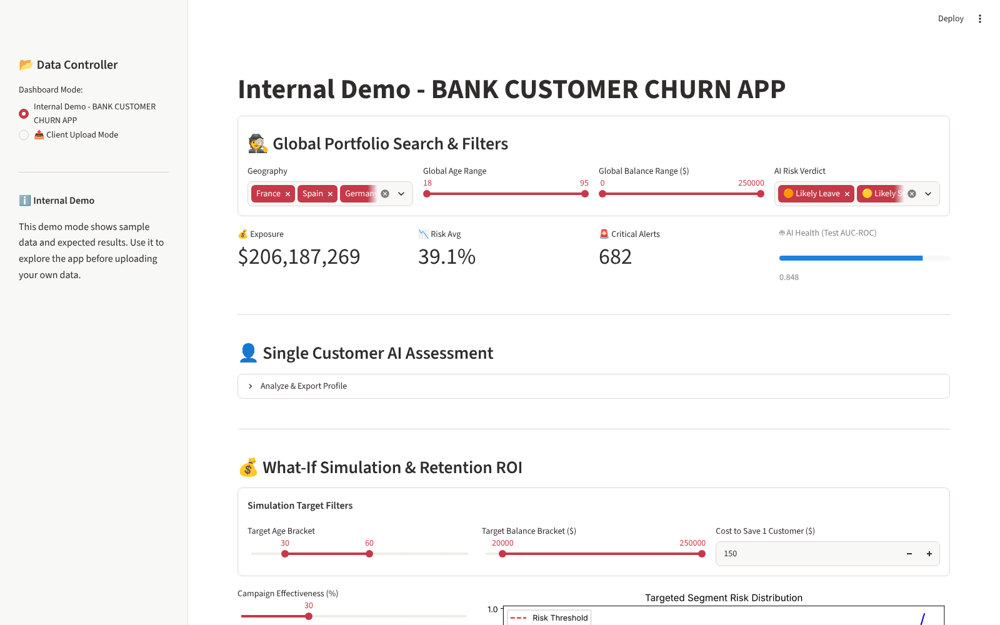

---

## 2. Filter by country, age, balance or risk

Use **Global Portfolio Search & Filters** to focus on a group of customers. Every KPI, chart and export updates instantly.

**Example:** keep only **Germany** in the Geography filter. Exposure drops from $206M to $94M, and the average risk rises from 39.1% to 47.4%, so German customers are clearly at higher risk.

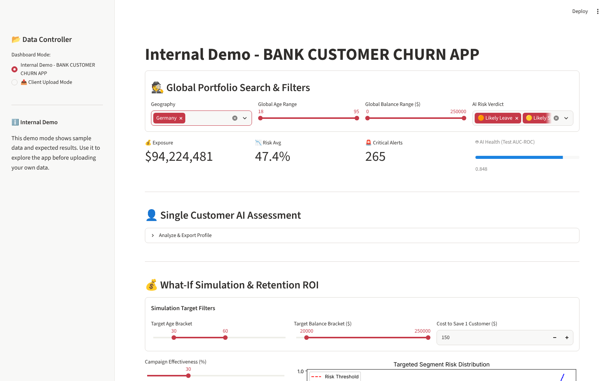

> 💡 Removing a verdict (for example *Highly Leave*) from **AI Risk Verdict** hides those customers everywhere.

---

## 3. Score a single customer

1. Open **Single Customer AI Assessment → Analyze & Export Profile**
2. Enter the customer's details: age, tenure, credit score, balance, products, status, credit card, salary and gender
3. Click **🚀 Run AI Analysis**

The app shows the **AI verdict**, the **churn probability** and the full feature table, including the engineered ratios.

**Example:** a 55-year-old inactive customer with 1 product and a $150K balance scores **86.8%**, which is 🔴 *Highly Leave*. A 30-year-old active customer with 7 years of tenure scores **27.8%**, which is 🟢 *Stay*.

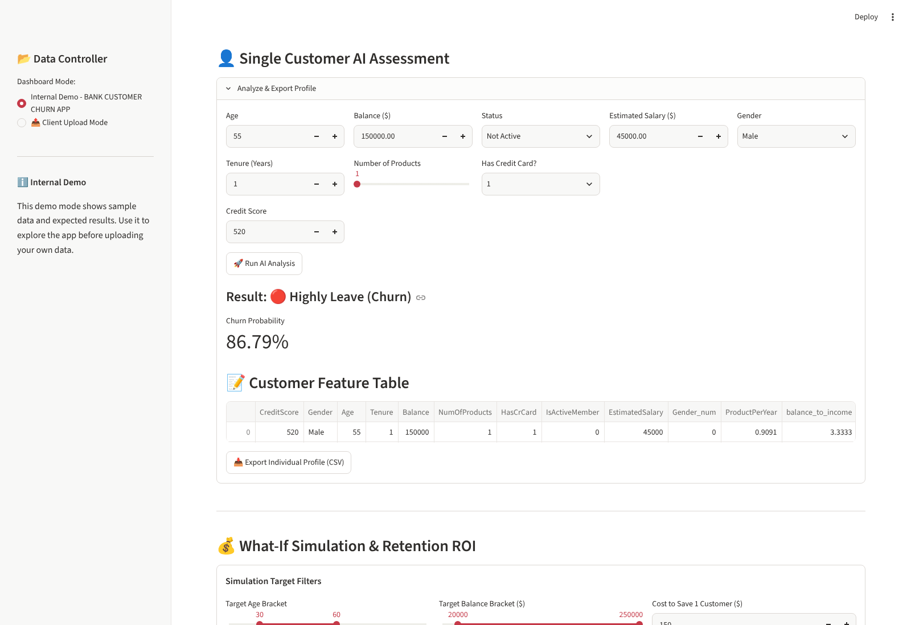

| Churn probability | Verdict |
|---|---|
| below 30% | 🟢 Stay (Safe) |
| 30% – 49% | 🟡 Likely Stay |
| 50% – 79% | 🟠 Likely Leave |
| 80% and above | 🔴 Highly Leave (Churn) |

---

## 4. Simulate a retention campaign (What-If ROI)

Plan a campaign before spending any budget:

1. Choose the **target age** and **balance** brackets
2. Set the **cost to save one customer**
3. Set the expected **campaign effectiveness (%)**

The simulator returns the **capital that could be saved**, the **total campaign cost** and the **ROI**. The chart shows the risk spread of the targeted customers against the model's decision threshold (red line).

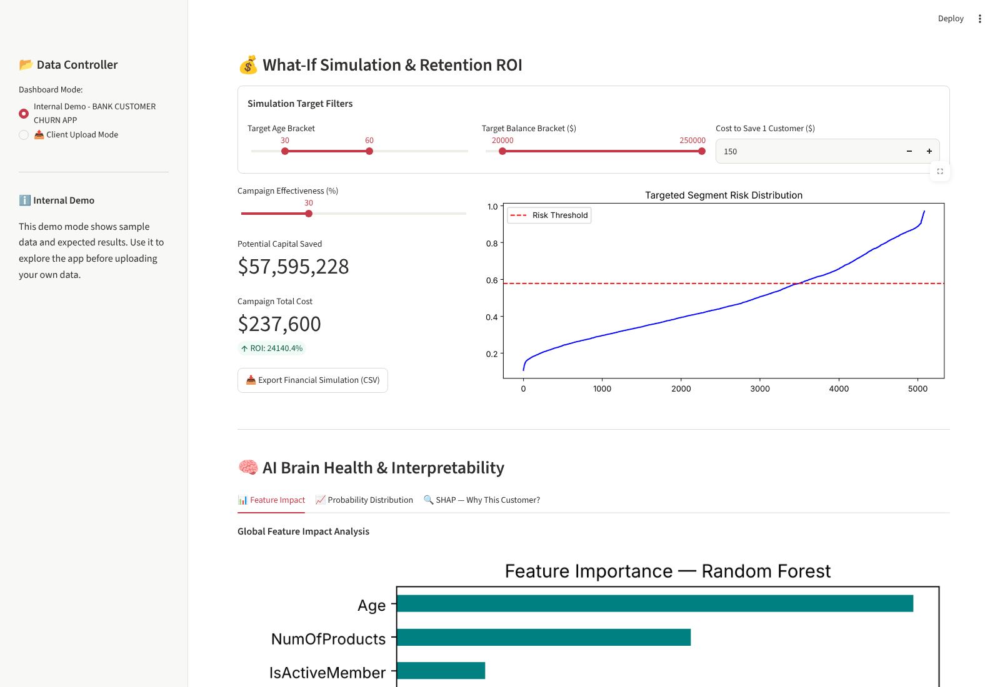

---

## 5. See what drives churn (Feature Impact)

The **📊 Feature Impact** tab ranks what the model relies on most. **Age** and **number of products** are by far the strongest churn drivers, followed by activity status and balance.

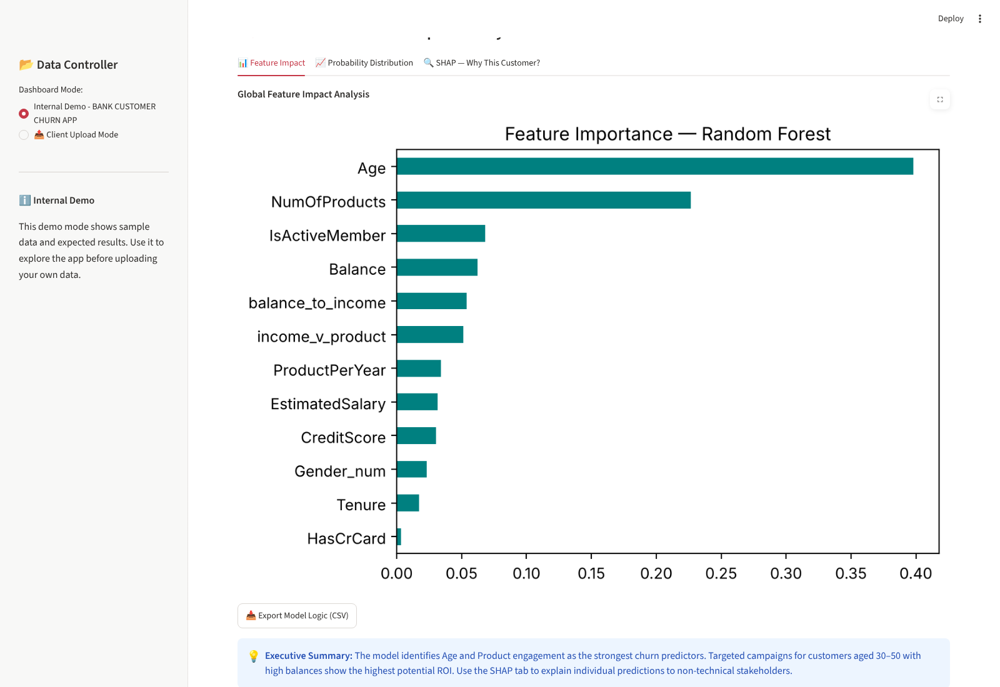

---

## 6. Check the risk spread (Probability Distribution)

The **📈 Probability Distribution** tab shows how churn risk is spread across the whole portfolio, so you can see how many customers sit in each risk band.

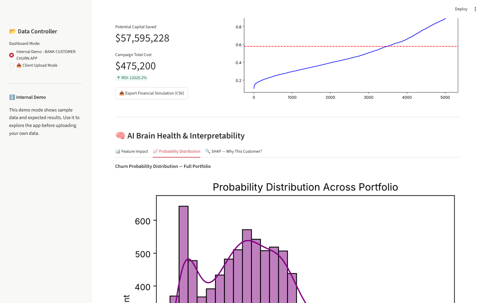

---

## 7. Explain one customer's prediction (SHAP)

1. Open the **🔍 SHAP — Why This Customer?** tab
2. Pick a **Customer ID**
3. Click **Explain This Customer**

Each factor is marked 🔴 when it **increases** that customer's churn risk and 🟢 when it **reduces** it. This makes the model's decision easy to explain to non-technical colleagues.

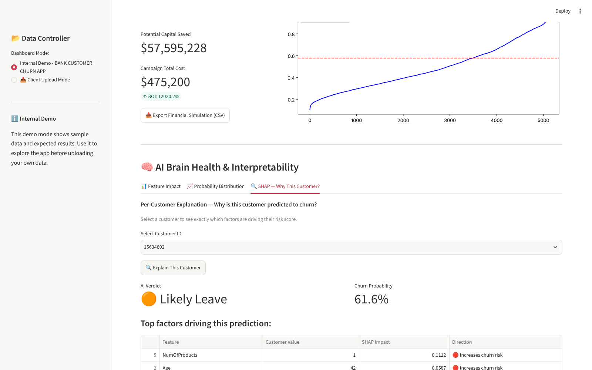

---

## 8. Analyse your own customer file (Upload mode)

1. In the sidebar, switch to **📤 Client Upload Mode**
2. Click **📥 Download Template CSV** to see the expected columns
3. Upload your CSV file

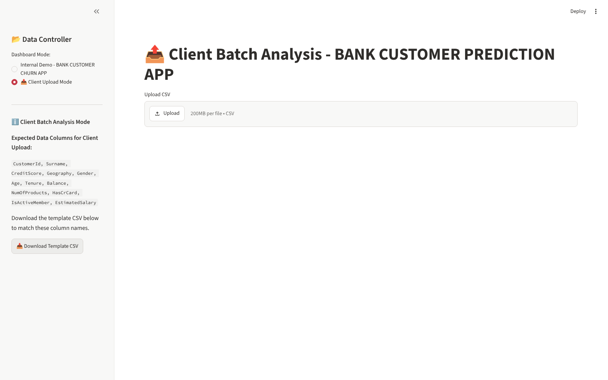

The whole dashboard (filters, KPIs, what-if, explanations) then runs on **your** customers:

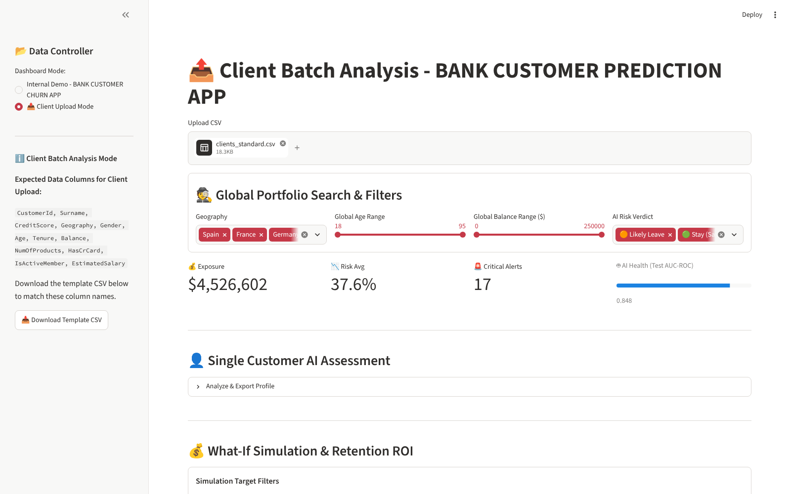

**The upload is forgiving:**
- **Different column names** are recognised automatically, for example `Salary`, `customer_age`, `account_balance` or `Country`
- **Currency formatting** like `$1,200.50` is cleaned automatically
- **Rows with invalid numbers** (for example `n/a`) are skipped, with a warning that says how many

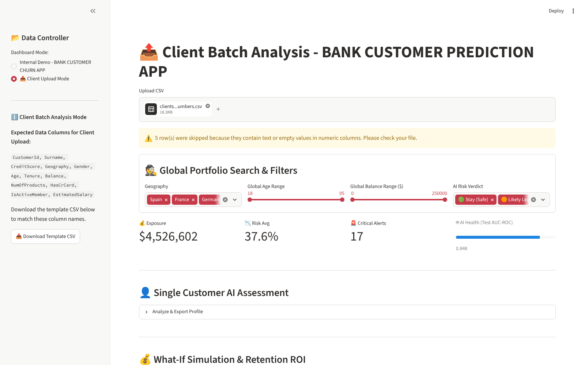

- **Missing required columns** stop the analysis with a clear message that names the missing column:

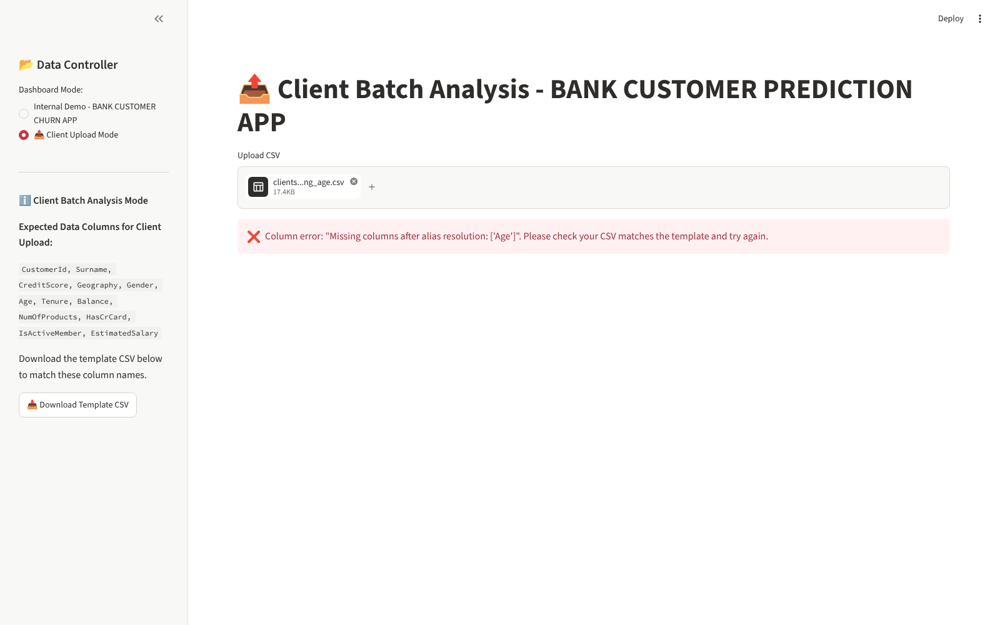

---

## 9. Exports

Every section can be exported to CSV:

| Export | File | Where |
|---|---|---|
| Single customer profile | `individual_assessment.csv` | Single Customer AI Assessment |
| Campaign simulation | `roi_simulation_report.csv` | What-If Simulation |
| Feature importances | `ai_model_logic.csv` | Feature Impact tab |
| Full scored portfolio | `master_churn_report.csv` | Probability Distribution tab |
| Customer explanation | `shap_explanation.csv` | SHAP tab |
| Upload template | `template.csv` | Sidebar (Upload mode) |

---

## 10. Tested scenarios

Every feature was tested end to end from a user's point of view:

| # | Scenario | Result |
|---|---|---|
| 1 | Demo mode loads with KPIs and model AUC | ✅ |
| 2 | Geography filter (Germany only) updates every KPI | ✅ |
| 3 | Removing the *Highly Leave* verdict sets Critical Alerts to 0 | ✅ |
| 4 | High-risk customer scored as 🔴 (86.8%) and exported | ✅ |
| 5 | Low-risk customer scored as 🟢 (27.8%) | ✅ |
| 6 | Changing the campaign cost updates cost and ROI | ✅ |
| 7 | Feature Impact, Probability Distribution and SHAP tabs work and export | ✅ |
| 8 | Template download | ✅ |
| 9 | Upload with standard column names | ✅ |
| 10 | Upload of the downloaded template | ✅ |
| 11 | Upload with custom column names (`credit_rating`, `customer_age`, `Country`…) | ✅ |
| 12 | Upload with currency formatting (`$1,200.50`) | ✅ |
| 13 | Upload with text in numeric columns: rows skipped with a warning | ✅ |
| 14 | Upload with a missing column: clear error message | ✅ |

[⬅ Back to README](../README.md)
